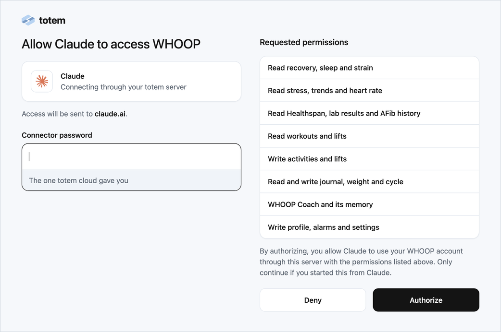

<p align="center"></p>

<h1 align="center">totem</h1>

<p align="center"><b>Tus datos de WHOOP en Claude, ChatGPT y las apps de IA que ya usas.</b><br>
Un servidor MCP de código abierto que ejecutas tú. Se configura con un solo comando.</p>

<p align="center">
  <a href="https://www.npmjs.com/package/@thebriangao/totem"></a>
  <a href="https://github.com/thebriangao/totem/actions/workflows/ci.yml"></a>
  <a href="../../TOOLS.md"></a>
  
  <a href="../../LICENSE"></a>
</p>

<p align="center">
  <a href="#inicio-rápido">Inicio rápido</a> ·
  <a href="#qué-puedes-preguntar">Qué puedes preguntar</a> ·
  <a href="#conecta-tus-apps">Conecta tus apps</a> ·
  <a href="#alojamiento">Alojamiento</a> ·
  <a href="../../TOOLS.md">Herramientas</a> ·
  <a href="#preguntas-frecuentes">Preguntas frecuentes</a>
</p>

<p align="center">
  <a href="../../README.md">English</a> ·
  <a href="README.zh-CN.md">简体中文</a> ·
  <a href="README.ja.md">日本語</a> ·
  <a href="README.ko.md">한국어</a> ·
  Español ·
  <a href="README.pt-BR.md">Português</a> ·
  <a href="README.fr.md">Français</a> ·
  <a href="README.de.md">Deutsch</a>
</p>

<p align="center">
  <picture>
    <source media="(prefers-color-scheme: dark)" srcset="../media/totem-local-dark.svg">
    
  </picture>
</p>

totem conecta tu cuenta de WHOOP con tus apps de IA. Pregunta cómo dormiste anoche, por qué tienes la recuperación baja o cómo ha cambiado tu VFC este trimestre. Pídele a la app que registre un entrenamiento o que rellene tu diario.

Es un servidor pequeño que habla [MCP](https://modelcontextprotocol.io) con tus apps y se comunica con WHOOP igual que la app de WHOOP. Lo ejecutas en tu ordenador o en un servidor en la nube que sea tuyo.

- **41 herramientas.** Recuperación, sueño, esfuerzo, estrés, frecuencia cardíaca, tendencias, entrenamientos, Strength Trainer, diario, WHOOP Coach, peso, seguimiento del ciclo, Smart Alarm, perfil y ajustes. [Míralas todas](../../TOOLS.md).
- **Nada cambia sin tu sí.** Toda herramienta que escribe muestra antes una vista previa y espera a que confirmes.
- **Ligero para el contexto.** Una respuesta normal ocupa unos 1,5 KB, así que las herramientas dejan sitio para la conversación.
- **Un solo comando.** `totem local` o `totem cloud` inicia tu sesión en WHOOP y añade totem a las apps de IA que encuentra.

> [!NOTE]
> totem usa la API privada de la app de WHOOP, no la API pública para desarrolladores, y no tiene relación con WHOOP. Lee las [preguntas frecuentes](#preguntas-frecuentes) antes de instalarlo.

## Inicio rápido

Necesitas [Node.js 24](https://nodejs.org) o posterior y una cuenta de WHOOP.

**1. Instálalo.**

```bash
npm install -g @thebriangao/totem
```

**2. Elige dónde se ejecuta.**

| | En este ordenador | En la nube |
|---|---|---|
| Comando | `totem local` | `totem cloud` |
| Funciona con | Apps de escritorio y de terminal: Claude Desktop, Claude Code, ChatGPT de escritorio y Codex, Cursor, VS Code, OpenCode, Antigravity | Todas esas, además de claude.ai, chatgpt.com y Claude en el móvil |
| Coste | Gratis | Gratis en Cloudflare, unos 4 $ al mes en Fly.io |
| Disponible | Mientras el ordenador está encendido | Siempre |

Los dos comandos abren una ventana del navegador en la propia web de WHOOP para que inicies sesión. totem nunca ve tu contraseña. Después busca las apps de IA de tu ordenador y te ofrece añadirse a cada una.

**3. Pregunta algo.**

Abre tu app y prueba con *"¿Qué tal dormí anoche?"*

Ejecuta `totem` sin nada más cuando quieras para ver cómo está todo.

### ¿Prefieres un botón?

[](https://deploy.workers.cloudflare.com/?url=https://github.com/thebriangao/totem)
[](https://railway.com/deploy/Z6CMWF)

- **Cloudflare** pide dos valores: `MCP_AUTH_TOKEN` (64 caracteres aleatorios, por ejemplo la salida de `openssl rand -hex 32`) y `AUTH_PASSWORD` (la contraseña que escribirás cuando una app se conecte). Funciona en el plan gratuito de Workers.
- **Railway** genera los dos por ti (están en las Variables del servicio). Necesita el plan de pago de Railway.

Después inicia sesión en WHOOP y envía esa sesión a tu servidor:

```bash
npx @thebriangao/totem auth --url https://your-server-address
```

**¿Solo usas Claude Desktop?** Descarga [totem.mcpb](https://github.com/thebriangao/totem/releases/latest/download/totem.mcpb), haz doble clic en él e inicia sesión una vez con `npx @thebriangao/totem auth --local`.

## Qué puedes preguntar

<p align="center">
  <picture>
    <source media="(prefers-color-scheme: dark)" srcset="../media/chat-answer-dark.png">
    
  </picture>
</p>

- "¿Qué tal dormí anoche y cómo se compara con el mes?"
- "¿Por qué tengo la recuperación baja hoy?"
- "Muéstrame mi VFC y mi frecuencia cardíaca en reposo de los últimos 90 días."
- "¿Cuál fue mi frecuencia cardíaca en la carrera de esta mañana?"
- "Registra un paseo de 30 minutos a las 6 de la tarde."
- "Ayer tomé cafeína y alcohol. Añádelo a mi diario."
- "Registra el entrenamiento de hoy: press de banca 3×5 con 80 kg, sentadilla 3×5 con 100 kg."
- "Pon una Smart Alarm a las 7:30 los días laborables."

Todo lo que escribe vuelve primero como vista previa. Tu app te enseña qué va a cambiar y te pregunta antes de hacerlo.

## Conecta tus apps

`totem connect` configura las apps de tu ordenador. Un servidor en la nube tiene además una página Connect en `https://your-server/connect`, con un botón o un paso listo para copiar para cada app, ya rellenado con la dirección de tu servidor.

<p align="center">
  <picture>
    <source media="(prefers-color-scheme: dark)" srcset="../media/connect-page-dark.png">
    
  </picture>
  <picture>
    <source media="(prefers-color-scheme: dark)" srcset="../media/consent-page-dark.png">
    
  </picture>
</p>

Con un servidor en la nube, cada app te lleva una vez a la página de inicio de sesión de totem. Indica qué app lo pide, muestra adónde irá el acceso y te pide tu contraseña de conexión.

<details>
<summary><b>Todas las apps, paso a paso</b></summary>

<br>

| App | En este ordenador | Con un servidor en la nube |
|---|---|---|
| claude.ai, Claude Desktop, Claude para móvil | El archivo de configuración de Claude Desktop | Un enlace que abre "Add custom connector" de claude.ai ya rellenado. Después aparece también en Desktop y en el móvil |
| Claude Code | `claude mcp add` | `claude mcp add --transport http` y luego `/mcp` para iniciar sesión |
| ChatGPT de escritorio y Codex | `codex mcp add` (comparten una configuración) | `codex mcp add --url`, que abre él mismo el inicio de sesión |
| chatgpt.com | Necesita un servidor en la nube | Plugins → Add → Add custom MCP server |
| Cursor | `~/.cursor/mcp.json` | Un enlace "Add to Cursor" |
| VS Code (Copilot) | `~/.copilot/mcp-config.json` | Un enlace "Add to VS Code" |
| OpenCode (1 y 2) | `opencode.json` | `opencode.json` y luego `opencode mcp auth whoop` |
| Antigravity | `~/.gemini/config/mcp_config.json` | El mismo archivo, con la dirección del servidor |

`totem connect <app>` configura una sola app, y `totem connect --print` muestra lo que añadiría sin tocar nada.

</details>

## Alojamiento

`totem cloud` despliega en cualquiera de estos y después comprueba que el servidor responde.

| Dónde | Coste | Conviene saber |
|---|---|---|
| **Cloudflare Workers** (recomendado) | Plan gratuito, 100 000 solicitudes al día | No hay ninguna máquina que cuidar. La sesión vive en un Durable Object. |
| **Fly.io** | Unos 4 $ al mes por una máquina de 512 MB en Virginia y un volumen de 1 GB | Siempre encendido. En el momento de escribir esto, Fly no cobra a las cuentas personales por menos de 5 $ al mes. |
| **Railway** | El plan de pago de Railway | Un panel y los registros en el navegador. |
| **Tu propio servidor** | Lo que te cueste | Cualquier host con Docker. totem escribe la configuración y te muestra los comandos, o puedes usar la imagen `ghcr.io/thebriangao/totem`. Monta un volumen en `/data`. |

Después, `totem status` comprueba el servidor y su sesión de WHOOP, `totem logs` muestra sus registros y `totem deploy` le envía una versión nueva.

## Cómo funciona

<p align="center">
  <picture>
    <source media="(prefers-color-scheme: dark)" srcset="../media/how-it-works-dark.svg">
    
  </picture>
</p>

Tus datos van de WHOOP a tu totem y de ahí a la app a la que preguntaste, y a ningún otro sitio. No hay una empresa totem en medio, ni un servidor compartido, ni analíticas.

### El inicio de sesión en WHOOP

1. `totem auth`, que `local` y `cloud` ejecutan por ti, abre una ventana nueva del navegador en app.whoop.com. Inicias sesión en la página de WHOOP, con su verificación en dos pasos.
2. totem solo lee las cookies de sesión de WHOOP de esa ventana. Después la cierra y borra el perfil temporal.
3. La sesión se guarda en un archivo que solo tú puedes leer (`~/.config/totem/tokens.json`) o en tu servidor: en su volumen o en el almacenamiento de un Durable Object de Cloudflare.
4. WHOOP cambia el token de actualización cada vez que se usa, así que una sesión solo puede estar en un sitio. totem la renueva por su cuenta, cada 12 horas y antes de que caduque, y guarda siempre primero el token nuevo.

Para volver a iniciar sesión, ejecuta `totem auth`.

### Seguridad

- **Tu servidor, tus claves.** Un servidor en la nube tiene dos secretos propios: `MCP_AUTH_TOKEN`, la clave del servidor, guardada en `~/.config/totem/deploy.json` en tu ordenador, y la contraseña de conexión que escribes cuando una app se conecta.
- **La página de inicio de sesión dice el destino.** Muestra la dirección real a la que va el acceso (claude.ai, chatgpt.com, una app de tu propio ordenador), nunca solo el nombre que dice tener una app.
- **El servidor habla con WHOOP y con tus apps, y con nadie más.** Sin telemetría ni analíticas.
- **Las escrituras necesitan confirmación,** y las de `whoop_raw` necesitan además `allow_write`.

Más información en [SECURITY.md](../../SECURITY.md).

## Comandos

| Comando | Qué hace |
|---|---|
| `totem` | Muestra cómo está esta instalación y qué ejecutar a continuación |
| `totem local` | Se ejecuta en este ordenador: inicia sesión y configura tus apps de IA |
| `totem cloud` | Despliega tu propio servidor, inicia su sesión y conecta tus apps |
| `totem connect [app]` | Vuelve a configurar tus apps, o solo una |
| `totem auth` | Inicia sesión en WHOOP (`--local`, `--url URL`, `--paste`, `--status`) |
| `totem status` / `ping` / `logs` | Comprueba el servidor y su sesión |
| `totem deploy` | Despliega esta versión en tu servidor |
| `totem update` | Actualiza totem (`--check`, `--auto on`) |
| `totem tools` | Lista las 41 herramientas |

`totem <command> --help` explica cada uno.

## Solución de problemas

**La app no muestra ninguna herramienta de WHOOP.** Reiníciala por completo. Si lo tienes en local, ejecuta `totem status`. Si usas un servidor, ejecuta `totem ping`.

**"No WHOOP login on this server."** Ejecuta `totem auth`. Envía la sesión a tu servidor si hay uno configurado, o la guarda en este ordenador.

**No se encontró ningún navegador para iniciar sesión.** totem usa Chrome, Chromium, Edge o Brave. Indícale otro con `TOTEM_BROWSER=/path/to/browser`, o ejecuta `totem auth --paste` y pega la cookie `whoop-auth-refresh-token` de un navegador con la sesión iniciada en app.whoop.com.

**La configuración de OpenCode u otra app tiene comentarios.** totem no reescribe archivos que no puede leer con exactitud. En OpenCode deja que el propio OpenCode añada el servidor. En otras apps muestra la entrada que hay que añadir.

**WHOOP responde con 5xx.** WHOOP tiene problemas. Vuelve a intentarlo en un minuto.

## Preguntas frecuentes

**¿Tiene el apoyo de WHOOP?**
No. totem usa la API privada de la app de WHOOP, que WHOOP no ofrece a terceros, y sus condiciones le permiten actuar contra las cuentas que usan herramientas no oficiales. Las solicitudes de totem se parecen a las de la app y van al ritmo de una persona, pero no hay garantía. Si perder tu cuenta de WHOOP sería un problema, no lo uses.

**¿Por qué no la API pública de WHOOP?**
Es de solo lectura y cubre una parte pequeña de los datos: sin diario, Strength Trainer, estrés, Coach, Smart Alarm, hipnograma ni tendencias, y sin escrituras. Si te basta con la recuperación, los totales de sueño y una lista de entrenamientos, úsala.

**¿Puedo compartir mi servidor con un amigo?**
No. Cada persona necesita su propio servidor y su propia sesión de WHOOP. Una sesión no se puede compartir, porque WHOOP cambia el token de actualización cada vez que se usa.

**¿Funciona con WHOOP 4.0 y 5.0/MG?**
Sí. La API depende de tu cuenta, no de tu pulsera.

**¿Adónde van mis datos?**
De WHOOP a tu servidor y de ahí a la app a la que preguntaste. totem no guarda copias, solo una caché en memoria de las lecturas recientes.

## Contribuir

Los issues y los pull requests son bienvenidos. Para trabajar en totem:

```bash
git clone https://github.com/thebriangao/totem && cd totem
npm install
npx tsc && npm link     # compila una vez y deja `totem` en tu PATH
totem test
```

[CONTRIBUTING.md](../../CONTRIBUTING.md) explica cómo está organizado el proyecto, y [WHOOP.md](../../WHOOP.md) documenta lo que se sabe de la API de WHOOP.

## Agradecimientos

Gracias a todas las personas que abrieron issues y pull requests para la v1 y la v2, a [Anthropic](https://anthropic.com) por MCP y a quienes han ido documentando partes de la API de WHOOP a lo largo de los años.

## Licencia

[MIT](../../LICENSE). "WHOOP" es una marca comercial de WHOOP, Inc. totem es un proyecto independiente y no está afiliado, respaldado ni vinculado a WHOOP.
