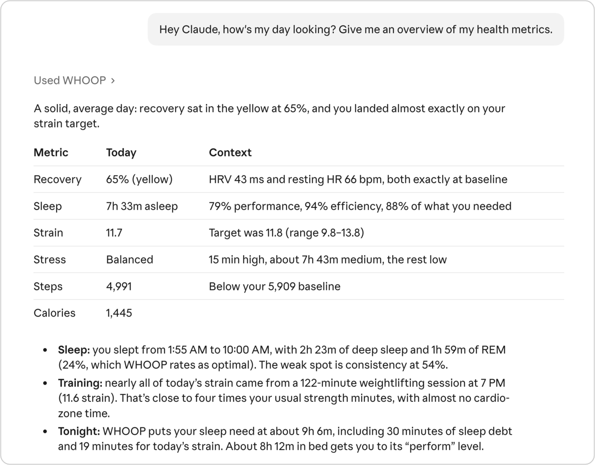
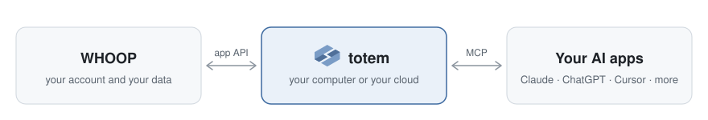

<p align="center"></p>

<h1 align="center">totem</h1>

<p align="center"><b>Vos données WHOOP dans Claude, ChatGPT et les applis d'IA que vous utilisez déjà.</b><br>
Un serveur MCP open source que vous faites tourner vous-même. Une seule commande pour l'installer.</p>

<p align="center">
  <a href="https://www.npmjs.com/package/@thebriangao/totem"></a>
  <a href="https://github.com/thebriangao/totem/actions/workflows/ci.yml"></a>
  <a href="../../TOOLS.md"></a>
  
  <a href="../../LICENSE"></a>
</p>

<p align="center">
  <a href="#démarrage-rapide">Démarrage rapide</a> ·
  <a href="#ce-que-vous-pouvez-demander">Ce que vous pouvez demander</a> ·
  <a href="#connecter-vos-applis">Connecter vos applis</a> ·
  <a href="#hébergement">Hébergement</a> ·
  <a href="../../TOOLS.md">Outils</a> ·
  <a href="#questions-fréquentes">Questions fréquentes</a>
</p>

<p align="center">
  <a href="../../README.md">English</a> ·
  <a href="README.zh-CN.md">简体中文</a> ·
  <a href="README.ja.md">日本語</a> ·
  <a href="README.ko.md">한국어</a> ·
  <a href="README.es.md">Español</a> ·
  <a href="README.pt-BR.md">Português</a> ·
  Français ·
  <a href="README.de.md">Deutsch</a>
</p>

<p align="center">
  <picture>
    <source media="(prefers-color-scheme: dark)" srcset="../media/totem-local-dark.svg">
    
  </picture>
</p>

totem relie votre compte WHOOP à vos applis d'IA. Demandez comment vous avez dormi cette nuit, pourquoi votre récupération est basse ou comment votre VFC a évolué ce trimestre. Laissez l'appli enregistrer une séance ou remplir votre journal.

C'est un petit serveur qui parle [MCP](https://modelcontextprotocol.io) à vos applis et communique avec WHOOP comme le fait l'appli WHOOP. Vous le faites tourner sur votre ordinateur ou sur un serveur cloud qui vous appartient.

- **41 outils.** Récupération, sommeil, effort, stress, fréquence cardiaque, tendances, séances, Strength Trainer, journal, WHOOP Coach, poids, suivi du cycle, Smart Alarm, profil et réglages. [Voir la liste complète](../../TOOLS.md).
- **Rien ne change sans votre accord.** Chaque outil qui écrit affiche d'abord un aperçu et attend votre confirmation.
- **Léger pour le contexte.** Une réponse standard pèse environ 1,5 Ko, ce qui laisse de la place à la conversation.
- **Une seule commande.** `totem local` ou `totem cloud` vous connecte à WHOOP et ajoute totem aux applis d'IA qu'il trouve.

> [!NOTE]
> totem utilise l'API privée de l'appli WHOOP, pas l'API publique pour développeurs, et n'a aucun lien avec WHOOP. Lisez les [questions fréquentes](#questions-fréquentes) avant de l'installer.

## Démarrage rapide

Il vous faut [Node.js 24](https://nodejs.org) ou plus récent et un compte WHOOP.

**1. Installez-le.**

```bash
npm install -g @thebriangao/totem
```

**2. Choisissez où il tourne.**

| | Sur cet ordinateur | Dans le cloud |
|---|---|---|
| Commande | `totem local` | `totem cloud` |
| Fonctionne avec | Les applis de bureau et de terminal : Claude Desktop, Claude Code, ChatGPT pour ordinateur et Codex, Cursor, VS Code, OpenCode, Antigravity | Toutes celles-là, plus claude.ai, chatgpt.com et Claude sur votre téléphone |
| Coût | Gratuit | Gratuit sur Cloudflare, environ 4 $ par mois sur Fly.io |
| Disponible | Tant que l'ordinateur est allumé | En permanence |

Les deux commandes ouvrent une fenêtre de navigateur sur le site de WHOOP pour que vous vous connectiez. totem ne voit jamais votre mot de passe. Il cherche ensuite les applis d'IA de votre ordinateur et propose de s'ajouter à chacune.

**3. Posez une question.**

Ouvrez votre appli et essayez *« Comment ai-je dormi cette nuit ? »*

Lancez `totem` tout seul à tout moment pour voir où vous en êtes.

### Vous préférez un bouton ?

[](https://deploy.workers.cloudflare.com/?url=https://github.com/thebriangao/totem)
[](https://railway.com/deploy/Z6CMWF)

- **Cloudflare** demande deux valeurs : `MCP_AUTH_TOKEN` (64 caractères aléatoires, par exemple la sortie de `openssl rand -hex 32`) et `AUTH_PASSWORD` (le mot de passe que vous saisirez quand une appli se connectera). Il tourne sur l'offre gratuite de Workers.
- **Railway** génère les deux pour vous (elles se trouvent dans les Variables du service). Il faut l'offre payante de Railway.

Connectez-vous ensuite à WHOOP et envoyez cette connexion à votre serveur :

```bash
npx @thebriangao/totem auth --url https://your-server-address
```

**Vous n'utilisez que Claude Desktop ?** Téléchargez [totem.mcpb](https://github.com/thebriangao/totem/releases/latest/download/totem.mcpb), double-cliquez dessus, puis connectez-vous une fois avec `npx @thebriangao/totem auth --local`.

## Ce que vous pouvez demander

<p align="center">
  <picture>
    <source media="(prefers-color-scheme: dark)" srcset="../media/chat-answer-dark.png">
    
  </picture>
</p>

- « Comment ai-je dormi cette nuit, et comment ça se compare au mois ? »
- « Pourquoi ma récupération est-elle basse aujourd'hui ? »
- « Montre ma VFC et ma fréquence cardiaque au repos sur les 90 derniers jours. »
- « Quelle était ma fréquence cardiaque pendant la course de ce matin ? »
- « Enregistre une marche de 30 minutes à 18 h. »
- « J'ai pris de la caféine et de l'alcool hier. Ajoute-le à mon journal. »
- « Enregistre la séance d'aujourd'hui : développé couché 3×5 à 80 kg, squat 3×5 à 100 kg. »
- « Règle une Smart Alarm à 7 h 30 en semaine. »

Tout ce qui écrit revient d'abord sous forme d'aperçu. Votre appli vous montre ce qui va changer et vous demande avant de le faire.

## Connecter vos applis

`totem connect` configure les applis de votre ordinateur. Un serveur cloud a aussi une page Connect à l'adresse `https://your-server/connect`, avec un bouton ou une étape prête à copier pour chaque appli, déjà remplie avec l'adresse de votre serveur.

<p align="center">
  <picture>
    <source media="(prefers-color-scheme: dark)" srcset="../media/connect-page-dark.png">
    
  </picture>
  <picture>
    <source media="(prefers-color-scheme: dark)" srcset="../media/consent-page-dark.png">
    
  </picture>
</p>

Avec un serveur cloud, chaque appli vous envoie une fois sur la page de connexion de totem. Elle nomme l'appli qui fait la demande, montre où ira l'accès et demande votre mot de passe de connexion.

<details>
<summary><b>Toutes les applis, pas à pas</b></summary>

<br>

| Appli | Sur cet ordinateur | Avec un serveur cloud |
|---|---|---|
| claude.ai, Claude Desktop, Claude mobile | Le fichier de configuration de Claude Desktop | Un lien qui ouvre « Add custom connector » de claude.ai déjà rempli. Il apparaît ensuite aussi dans Desktop et sur votre téléphone |
| Claude Code | `claude mcp add` | `claude mcp add --transport http`, puis `/mcp` pour vous connecter |
| ChatGPT pour ordinateur et Codex | `codex mcp add` (ils partagent une configuration) | `codex mcp add --url`, qui ouvre lui-même la connexion |
| chatgpt.com | Nécessite un serveur cloud | Plugins → Add → Add custom MCP server |
| Cursor | `~/.cursor/mcp.json` | Un lien « Add to Cursor » |
| VS Code (Copilot) | `~/.copilot/mcp-config.json` | Un lien « Add to VS Code » |
| OpenCode (1 et 2) | `opencode.json` | `opencode.json`, puis `opencode mcp auth whoop` |
| Antigravity | `~/.gemini/config/mcp_config.json` | Le même fichier, avec l'adresse du serveur |

`totem connect <app>` configure une seule appli, et `totem connect --print` affiche ce qu'il ajouterait sans toucher à rien.

</details>

## Hébergement

`totem cloud` déploie sur l'un de ces hébergeurs, puis vérifie que le serveur répond.

| Hébergeur | Coût | Bon à savoir |
|---|---|---|
| **Cloudflare Workers** (recommandé) | Offre gratuite, 100 000 requêtes par jour | Aucune machine à surveiller. La connexion est stockée dans un Durable Object. |
| **Fly.io** | Environ 4 $ par mois pour une machine de 512 Mo en Virginie et un volume de 1 Go | Toujours allumé. À l'heure où ces lignes sont écrites, Fly ne facture pas les comptes personnels en dessous de 5 $ par mois. |
| **Railway** | L'offre payante de Railway | Un tableau de bord et les journaux dans le navigateur. |
| **Votre propre serveur** | À vous de voir | N'importe quel hôte Docker. totem écrit la configuration et affiche les commandes, ou utilisez l'image `ghcr.io/thebriangao/totem`. Montez un volume sur `/data`. |

Ensuite, `totem status` vérifie le serveur et sa connexion WHOOP, `totem logs` affiche ses journaux et `totem deploy` lui envoie une nouvelle version.

## Comment ça marche

<p align="center">
  <picture>
    <source media="(prefers-color-scheme: dark)" srcset="../media/how-it-works-dark.svg">
    
  </picture>
</p>

Vos données vont de WHOOP à votre totem, puis à l'appli que vous avez interrogée, et nulle part ailleurs. Il n'y a pas d'entreprise totem au milieu, pas de serveur partagé et pas de mesure d'audience.

### La connexion à WHOOP

1. `totem auth`, que `local` et `cloud` lancent pour vous, ouvre une nouvelle fenêtre de navigateur sur app.whoop.com. Vous vous connectez sur la page de WHOOP, vérification en deux étapes comprise.
2. totem ne lit que les cookies de session de WHOOP dans cette fenêtre, puis la ferme et supprime le profil temporaire.
3. La connexion est gardée dans un fichier que vous seul pouvez lire (`~/.config/totem/tokens.json`), ou sur votre serveur : sur son volume, ou dans le stockage d'un Durable Object Cloudflare.
4. WHOOP remplace le jeton de rafraîchissement à chaque utilisation, donc une connexion ne peut se trouver qu'à un seul endroit. totem la renouvelle tout seul, toutes les 12 heures et avant son expiration, en enregistrant toujours d'abord le nouveau jeton.

Pour vous reconnecter, lancez `totem auth`.

### Sécurité

- **Votre serveur, vos clés.** Un serveur cloud a deux secrets qui lui sont propres : `MCP_AUTH_TOKEN`, la clé du serveur, gardée dans `~/.config/totem/deploy.json` sur votre ordinateur, et le mot de passe de connexion que vous saisissez quand une appli se connecte.
- **La page de connexion nomme la destination.** Elle affiche l'adresse réelle à laquelle l'accès est envoyé (claude.ai, chatgpt.com, une appli sur votre propre ordinateur), jamais seulement le nom qu'une appli prétend avoir.
- **Le serveur parle à WHOOP et à vos applis, à personne d'autre.** Pas de télémétrie, pas de mesure d'audience.
- **Les écritures demandent une confirmation,** et celles de `whoop_raw` demandent en plus `allow_write`.

Plus de détails dans [SECURITY.md](../../SECURITY.md).

## Commandes

| Commande | Ce qu'elle fait |
|---|---|
| `totem` | Affiche où en est cette installation et quoi lancer ensuite |
| `totem local` | Tourne sur cet ordinateur : vous connecte, puis configure vos applis d'IA |
| `totem cloud` | Déploie votre propre serveur, le connecte à WHOOP et relie vos applis |
| `totem connect [app]` | Configure à nouveau vos applis, ou une seule |
| `totem auth` | Vous connecte à WHOOP (`--local`, `--url URL`, `--paste`, `--status`) |
| `totem status` / `ping` / `logs` | Vérifie le serveur et sa connexion |
| `totem deploy` | Déploie cette version sur votre serveur |
| `totem update` | Met totem à jour (`--check`, `--auto on`) |
| `totem tools` | Liste les 41 outils |

`totem <command> --help` explique chacune.

## Dépannage

**L'appli n'affiche aucun outil WHOOP.** Redémarrez-la complètement. Pour une installation locale, lancez `totem status`. Pour un serveur, lancez `totem ping`.

**"No WHOOP login on this server."** Lancez `totem auth`. Il envoie la connexion à votre serveur s'il y en a un de configuré, ou l'enregistre sur cet ordinateur.

**Aucun navigateur n'a été trouvé pour la connexion.** totem utilise Chrome, Chromium, Edge ou Brave. Indiquez-en un autre avec `TOTEM_BROWSER=/path/to/browser`, ou lancez `totem auth --paste` et collez le cookie `whoop-auth-refresh-token` d'un navigateur connecté à app.whoop.com.

**La configuration d'OpenCode ou d'une autre appli contient des commentaires.** totem ne réécrit pas les fichiers qu'il ne peut pas lire exactement. Pour OpenCode, il laisse OpenCode ajouter le serveur lui-même. Pour les autres, il affiche l'entrée à ajouter.

**WHOOP répond 5xx.** WHOOP a un souci. Réessayez dans une minute.

## Questions fréquentes

**WHOOP le prend-il en charge ?**
Non. totem utilise l'API privée de l'appli WHOOP, que WHOOP ne propose pas aux tiers, et les conditions de WHOOP lui permettent d'agir contre les comptes qui utilisent des outils non officiels. Les requêtes de totem ressemblent à celles de l'appli et restent au rythme d'une personne, mais rien n'est garanti. Si perdre votre compte WHOOP vous poserait problème, ne l'utilisez pas.

**Pourquoi pas l'API publique de WHOOP ?**
Elle est en lecture seule et ne couvre qu'une petite partie des données : pas de journal, de Strength Trainer, de stress, de Coach, de Smart Alarm, d'hypnogramme ni de tendances, et aucune écriture. Si la récupération, les totaux de sommeil et une liste de séances vous suffisent, utilisez-la.

**Puis-je partager mon serveur avec un ami ?**
Non. Chacun a besoin de son propre serveur et de sa propre connexion WHOOP. Une connexion ne se partage pas, car WHOOP remplace le jeton de rafraîchissement à chaque utilisation.

**Ça marche avec WHOOP 4.0 et 5.0/MG ?**
Oui. L'API dépend de votre compte, pas de votre bracelet.

**Où vont mes données ?**
De WHOOP à votre serveur, puis à l'appli que vous avez interrogée. totem ne garde aucune copie, seulement un cache en mémoire des lectures récentes.

## Contribuer

Les issues et les pull requests sont les bienvenues. Pour travailler sur totem :

```bash
git clone https://github.com/thebriangao/totem && cd totem
npm install
npx tsc && npm link     # compile une fois et met `totem` dans votre PATH
totem test
```

[CONTRIBUTING.md](../../CONTRIBUTING.md) explique comment le projet est organisé, et [WHOOP.md](../../WHOOP.md) documente ce que l'on sait de l'API de WHOOP.

## Remerciements

Merci à toutes les personnes qui ont ouvert des issues et des pull requests pour la v1 et la v2, à [Anthropic](https://anthropic.com) pour MCP, et à celles et ceux qui ont documenté des morceaux de l'API de WHOOP au fil des années.

## Licence

[MIT](../../LICENSE). « WHOOP » est une marque de WHOOP, Inc. totem est un projet indépendant, sans affiliation ni lien avec WHOOP, et n'est pas approuvé par WHOOP.
