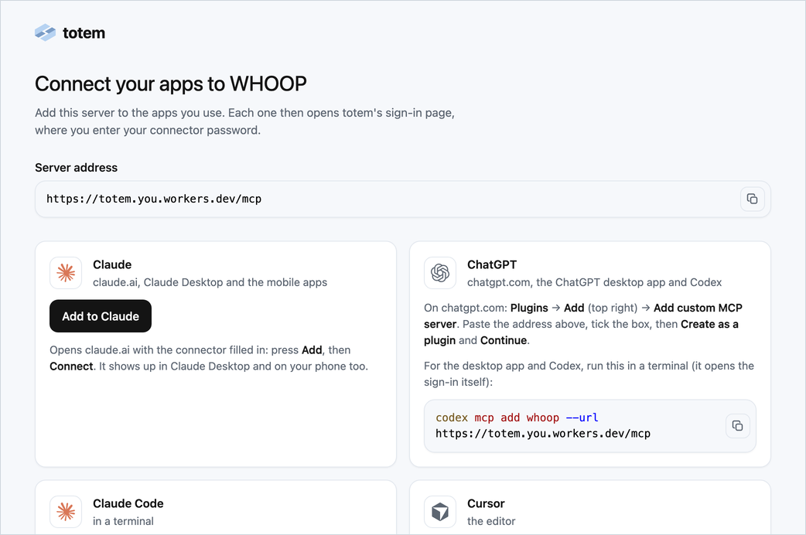

<p align="center"></p>

<h1 align="center">totem</h1>

<p align="center"><b>내 WHOOP 데이터를 Claude, ChatGPT 등 평소 쓰는 AI 앱에서.</b><br>
직접 실행하는 오픈소스 MCP 서버. 명령 하나로 설정이 끝납니다.</p>

<p align="center">
  <a href="https://www.npmjs.com/package/@thebriangao/totem"></a>
  <a href="https://github.com/thebriangao/totem/actions/workflows/ci.yml"></a>
  <a href="../../TOOLS.md"></a>
  
  <a href="../../LICENSE"></a>
</p>

<p align="center">
  <a href="#빠른-시작">빠른 시작</a> ·
  <a href="#물어볼-수-있는-것">물어볼 수 있는 것</a> ·
  <a href="#앱-연결하기">앱 연결하기</a> ·
  <a href="#호스팅">호스팅</a> ·
  <a href="../../TOOLS.md">도구</a> ·
  <a href="#자주-묻는-질문">자주 묻는 질문</a>
</p>

<p align="center">
  <a href="../../README.md">English</a> ·
  <a href="README.zh-CN.md">简体中文</a> ·
  <a href="README.ja.md">日本語</a> ·
  한국어 ·
  <a href="README.es.md">Español</a> ·
  <a href="README.pt-BR.md">Português</a> ·
  <a href="README.fr.md">Français</a> ·
  <a href="README.de.md">Deutsch</a>
</p>

<p align="center">
  <picture>
    <source media="(prefers-color-scheme: dark)" srcset="../media/totem-local-dark.svg">
    
  </picture>
</p>

totem은 WHOOP 계정을 AI 앱에 연결합니다. 어젯밤 수면, 회복이 낮은 이유, 이번 분기의 HRV 변화 같은 것을 물어보세요. 운동 기록이나 저널 작성도 앱에 맡길 수 있습니다.

totem은 작은 서버입니다. 앱과는 [MCP](https://modelcontextprotocol.io)로 대화하고, WHOOP과는 WHOOP 앱과 같은 방식으로 통신합니다. 내 컴퓨터나 내가 가진 클라우드 서버에서 실행합니다.

- **41개 도구.** 회복, 수면, 스트레인, 스트레스, 심박수, 트렌드, 운동, Strength Trainer, 저널, WHOOP Coach, 체중, 생리 주기 기록, Smart Alarm, 프로필과 설정. [전체 보기](../../TOOLS.md).
- **허락 없이는 아무것도 바뀌지 않습니다.** 데이터를 쓰는 도구는 항상 미리보기를 먼저 보여 주고 확인을 기다립니다.
- **컨텍스트를 아낍니다.** 기본 응답은 약 1.5 KB라서 대화에 쓸 공간이 넉넉히 남습니다.
- **명령 하나.** `totem local` 또는 `totem cloud`가 WHOOP 로그인을 처리하고, 찾은 AI 앱에 totem을 추가합니다.

> [!NOTE]
> totem은 공개 개발자 API가 아니라 WHOOP 앱의 비공개 API를 사용하며, WHOOP과 관련이 없습니다. 설치하기 전에 [자주 묻는 질문](#자주-묻는-질문)을 읽어 주세요.

## 빠른 시작

[Node.js 24](https://nodejs.org) 이상과 WHOOP 계정이 필요합니다.

**1. 설치합니다.**

```bash
npm install -g @thebriangao/totem
```

**2. 실행할 곳을 고릅니다.**

| | 이 컴퓨터에서 | 클라우드에서 |
|---|---|---|
| 명령 | `totem local` | `totem cloud` |
| 지원 앱 | 데스크톱과 터미널 앱: Claude Desktop, Claude Code, ChatGPT 데스크톱과 Codex, Cursor, VS Code, OpenCode, Antigravity | 왼쪽의 모든 앱에 더해 claude.ai, chatgpt.com, 휴대폰의 Claude |
| 비용 | 무료 | Cloudflare는 무료, Fly.io는 월 약 4달러 |
| 사용 가능 시간 | 컴퓨터가 켜져 있는 동안 | 항상 |

두 명령 모두 WHOOP 자체 사이트에서 브라우저 창을 열어 로그인하게 합니다. totem은 비밀번호를 절대 보지 않습니다. 그런 다음 컴퓨터에 있는 AI 앱을 찾아 각 앱에 totem을 추가할지 물어봅니다.

**3. 물어봅니다.**

앱을 열고 *"어젯밤 잠은 어땠어?"* 라고 물어보세요.

언제든 `totem`만 실행하면 현재 상태를 볼 수 있습니다.

### 버튼으로 하고 싶다면

[](https://deploy.workers.cloudflare.com/?url=https://github.com/thebriangao/totem)
[](https://railway.com/deploy/Z6CMWF)

- **Cloudflare**는 두 가지 값을 묻습니다. `MCP_AUTH_TOKEN`(무작위 64자. 예: `openssl rand -hex 32`의 출력)과 `AUTH_PASSWORD`(앱이 연결될 때 입력할 비밀번호)입니다. 무료 Workers 요금제에서 동작합니다.
- **Railway**는 두 값을 자동으로 만듭니다(서비스의 Variables에서 볼 수 있습니다). Railway 유료 요금제가 필요합니다.

그런 다음 WHOOP에 로그인하고 그 로그인을 서버로 보냅니다.

```bash
npx @thebriangao/totem auth --url https://your-server-address
```

**Claude Desktop만 쓰나요?** [totem.mcpb](https://github.com/thebriangao/totem/releases/latest/download/totem.mcpb)를 내려받아 더블클릭한 뒤 `npx @thebriangao/totem auth --local`로 한 번 로그인하세요.

## 물어볼 수 있는 것

<p align="center">
  <picture>
    <source media="(prefers-color-scheme: dark)" srcset="../media/chat-answer-dark.png">
    
  </picture>
</p>

- "어젯밤 잠은 어땠어? 이번 달과 비교하면?"
- "오늘 회복이 왜 낮아?"
- "지난 90일 동안의 HRV와 안정 시 심박수를 보여 줘."
- "오늘 아침 달리기 때 심박수는?"
- "오후 6시에 30분 걷기를 기록해 줘."
- "어제 카페인과 술을 마셨어. 저널에 추가해 줘."
- "오늘 운동 기록해 줘: 벤치프레스 80 kg 3×5, 스쿼트 100 kg 3×5."
- "평일 7시 30분에 Smart Alarm을 맞춰 줘."

쓰기 작업은 모두 미리보기로 먼저 돌아옵니다. 앱이 무엇이 바뀌는지 보여 주고, 실행하기 전에 확인을 받습니다.

## 앱 연결하기

`totem connect`는 내 컴퓨터에 있는 앱을 설정합니다. 클라우드 서버에는 `https://your-server/connect`에 Connect 페이지도 있어서, 앱마다 버튼이나 바로 복사할 수 있는 단계가 서버 주소까지 채워져 있습니다.

<p align="center">
  <picture>
    <source media="(prefers-color-scheme: dark)" srcset="../media/connect-page-dark.png">
    
  </picture>
  <picture>
    <source media="(prefers-color-scheme: dark)" srcset="../media/consent-page-dark.png">
    
  </picture>
</p>

클라우드 서버를 쓰면 앱마다 한 번씩 totem의 로그인 페이지로 이동합니다. 이 페이지는 어떤 앱이 요청하는지, 접근 권한이 어디로 가는지 보여 주고 연결 비밀번호를 묻습니다.

<details>
<summary><b>앱별 단계</b></summary>

<br>

| 앱 | 이 컴퓨터에서 | 클라우드 서버로 |
|---|---|---|
| claude.ai, Claude Desktop, Claude 모바일 | Claude Desktop의 설정 파일 | claude.ai의 "Add custom connector"를 채워진 상태로 여는 링크. 이후 데스크톱과 휴대폰에도 나타납니다 |
| Claude Code | `claude mcp add` | `claude mcp add --transport http`, 그다음 `/mcp`로 로그인 |
| ChatGPT 데스크톱과 Codex | `codex mcp add`(설정을 함께 씁니다) | `codex mcp add --url`. 로그인 페이지를 직접 엽니다 |
| chatgpt.com | 클라우드 서버 필요 | Plugins → Add → Add custom MCP server |
| Cursor | `~/.cursor/mcp.json` | "Add to Cursor" 링크 |
| VS Code (Copilot) | `~/.copilot/mcp-config.json` | "Add to VS Code" 링크 |
| OpenCode(1과 2) | `opencode.json` | `opencode.json`, 그다음 `opencode mcp auth whoop` |
| Antigravity | `~/.gemini/config/mcp_config.json` | 같은 파일에 서버 주소를 넣습니다 |

`totem connect <app>`은 앱 하나만 설정하고, `totem connect --print`는 아무것도 건드리지 않고 추가할 내용만 보여 줍니다.

</details>

## 호스팅

`totem cloud`는 아래 어디에든 배포하고, 배포 후 서버가 응답하는지 확인합니다.

| 호스트 | 비용 | 알아 둘 점 |
|---|---|---|
| **Cloudflare Workers**(추천) | 무료 요금제, 하루 100,000건 요청 | 관리할 머신이 없습니다. 로그인은 Durable Object에 보관됩니다. |
| **Fly.io** | 월 약 4달러. 버지니아의 512 MB 머신 한 대와 1 GB 볼륨 | 항상 켜져 있습니다. 이 글을 쓰는 시점에 Fly는 월 5달러 미만인 개인 계정에는 요금을 청구하지 않습니다. |
| **Railway** | Railway 유료 요금제 | 브라우저에서 대시보드와 로그를 볼 수 있습니다. |
| **내 서버** | 내가 정하기 나름 | Docker가 돌아가는 호스트면 됩니다. totem이 설정을 써 주고 실행할 명령을 출력하며, 이미지 `ghcr.io/thebriangao/totem`을 써도 됩니다. `/data`에 볼륨을 마운트하세요. |

배포한 뒤에는 `totem status`로 서버와 WHOOP 로그인을 확인하고, `totem logs`로 로그를 보고, `totem deploy`로 새 버전을 보냅니다.

## 동작 방식

<p align="center">
  <picture>
    <source media="(prefers-color-scheme: dark)" srcset="../media/how-it-works-dark.svg">
    
  </picture>
</p>

데이터는 WHOOP에서 내 totem으로, 그리고 질문한 앱으로 갈 뿐 다른 곳으로는 가지 않습니다. 중간에 totem 회사도, 공유 서버도, 분석 도구도 없습니다.

### WHOOP 로그인

1. `totem auth`(`local`과 `cloud`가 대신 실행합니다)는 app.whoop.com에서 새 브라우저 창을 엽니다. 로그인은 WHOOP 자체 페이지에서, 2단계 인증까지 포함해 진행합니다.
2. totem은 그 창에서 WHOOP의 세션 쿠키만 읽은 다음 창을 닫고 임시 프로필을 지웁니다.
3. 로그인은 나만 읽을 수 있는 파일(`~/.config/totem/tokens.json`)이나 서버의 볼륨, 또는 Cloudflare Durable Object 저장소에 보관됩니다.
4. WHOOP은 리프레시 토큰을 쓸 때마다 새것으로 바꾸므로, 하나의 로그인은 한 곳에서만 가질 수 있습니다. totem은 12시간마다, 그리고 만료 전에 스스로 갱신하며 새 토큰을 항상 먼저 저장합니다.

다시 로그인하려면 `totem auth`를 실행하세요.

### 보안

- **내 서버, 내 키.** 클라우드 서버에는 자체 비밀이 두 개 있습니다. `MCP_AUTH_TOKEN`(서버의 키. 내 컴퓨터의 `~/.config/totem/deploy.json`에 보관)과 앱이 연결될 때 입력하는 연결 비밀번호입니다.
- **로그인 페이지는 목적지를 밝힙니다.** 접근 권한이 실제로 가는 주소(claude.ai, chatgpt.com, 내 컴퓨터의 앱)를 보여 주며, 앱이 스스로 내세우는 이름만 보여 주는 일은 없습니다.
- **서버는 WHOOP과 내 앱하고만 통신합니다.** 텔레메트리도 분석도 없습니다.
- **쓰기에는 확인이 필요합니다.** `whoop_raw`의 쓰기에는 `allow_write`도 필요합니다.

자세한 내용은 [SECURITY.md](../../SECURITY.md)에 있습니다.

## 명령

| 명령 | 하는 일 |
|---|---|
| `totem` | 현재 설치 상태와 다음에 실행할 명령을 보여 줍니다 |
| `totem local` | 이 컴퓨터에서 실행: 로그인한 뒤 AI 앱을 설정합니다 |
| `totem cloud` | 내 서버를 배포하고, 로그인하고, 앱을 연결합니다 |
| `totem connect [app]` | 앱을 다시 설정합니다. 하나만 할 수도 있습니다 |
| `totem auth` | WHOOP에 로그인합니다(`--local`, `--url URL`, `--paste`, `--status`) |
| `totem status` / `ping` / `logs` | 서버와 로그인 상태를 확인합니다 |
| `totem deploy` | 이 버전을 서버에 배포합니다 |
| `totem update` | totem을 업데이트합니다(`--check`, `--auto on`) |
| `totem tools` | 41개 도구를 나열합니다 |

`totem <command> --help`로 각 명령의 설명을 볼 수 있습니다.

## 문제 해결

**앱에 WHOOP 도구가 보이지 않아요.** 앱을 완전히 종료했다가 다시 여세요. 로컬 설정이면 `totem status`를, 서버라면 `totem ping`을 실행하세요.

**"No WHOOP login on this server."** `totem auth`를 실행하세요. 서버가 설정되어 있으면 로그인을 서버로 보내고, 아니면 이 컴퓨터에 저장합니다.

**로그인에 쓸 브라우저를 찾지 못했어요.** totem은 Chrome, Chromium, Edge, Brave를 씁니다. 다른 브라우저는 `TOTEM_BROWSER=/path/to/browser`로 지정하거나, `totem auth --paste`를 실행해 app.whoop.com에 로그인된 브라우저의 `whoop-auth-refresh-token` 쿠키를 붙여 넣으세요.

**OpenCode 같은 앱의 설정 파일에 주석이 있어요.** totem은 정확히 읽을 수 없는 파일을 다시 쓰지 않습니다. OpenCode는 OpenCode가 직접 서버를 추가하게 하고, 다른 앱은 추가할 항목을 출력합니다.

**WHOOP이 5xx를 돌려줘요.** WHOOP 쪽 문제입니다. 1분 뒤에 다시 시도하세요.

## 자주 묻는 질문

**WHOOP이 공식 지원하나요?**
아니요. totem은 WHOOP 앱의 비공개 API를 사용합니다. WHOOP은 이 API를 제3자에게 제공하지 않으며, 약관에 따라 비공식 도구를 쓰는 계정에 조치를 취할 수 있습니다. totem의 요청은 앱의 요청처럼 보이고 사람이 쓰는 속도로 유지되지만, 보장은 없습니다. WHOOP 계정을 잃으면 곤란하다면 사용하지 마세요.

**왜 WHOOP의 공개 API를 쓰지 않나요?**
공개 API는 읽기 전용이고 데이터의 일부만 다룹니다. 저널, Strength Trainer, 스트레스, Coach, Smart Alarm, 수면 단계 그래프, 트렌드가 없고 쓰기도 안 됩니다. 회복, 수면 합계, 운동 목록이면 충분하다면 공개 API를 쓰세요.

**친구와 서버를 같이 써도 되나요?**
아니요. 각자 자신의 서버와 자신의 WHOOP 로그인이 필요합니다. WHOOP이 쓸 때마다 리프레시 토큰을 바꾸기 때문에 로그인은 공유할 수 없습니다.

**WHOOP 4.0과 5.0/MG에서 되나요?**
됩니다. API는 밴드가 아니라 계정에 따라 달라집니다.

**제 데이터는 어디로 가나요?**
WHOOP에서 내 서버로, 그리고 질문한 앱으로 갑니다. totem은 사본을 남기지 않고, 최근 읽은 내용을 메모리에 캐시할 뿐입니다.

## 기여하기

이슈와 풀 리퀘스트를 환영합니다. totem을 개발하려면:

```bash
git clone https://github.com/thebriangao/totem && cd totem
npm install
npx tsc && npm link     # 한 번 빌드하고 `totem`을 PATH에 올립니다
totem test
```

프로젝트 구조는 [CONTRIBUTING.md](../../CONTRIBUTING.md)에, WHOOP API에 대해 알려진 내용은 [WHOOP.md](../../WHOOP.md)에 정리되어 있습니다.

## 감사의 말

v1과 v2에 이슈와 풀 리퀘스트를 보내 주신 모든 분, MCP를 만든 [Anthropic](https://anthropic.com), 그리고 오랫동안 WHOOP API를 조금씩 문서로 남겨 주신 분들께 감사드립니다.

## 라이선스

[MIT](../../LICENSE). "WHOOP"은 WHOOP, Inc.의 상표입니다. totem은 독립 프로젝트이며 WHOOP과 제휴, 보증, 연관 관계가 없습니다.
