<p align="center"></p>

<h1 align="center">totem</h1>

<p align="center"><b>Seus dados do WHOOP no Claude, no ChatGPT e nos apps de IA que você já usa.</b><br>
Um servidor MCP de código aberto que você mesmo roda. Um comando configura tudo.</p>

<p align="center">
  <a href="https://www.npmjs.com/package/@thebriangao/totem"></a>
  <a href="https://github.com/thebriangao/totem/actions/workflows/ci.yml"></a>
  <a href="../../TOOLS.md"></a>
  
  <a href="../../LICENSE"></a>
</p>

<p align="center">
  <a href="#início-rápido">Início rápido</a> ·
  <a href="#o-que-você-pode-perguntar">O que você pode perguntar</a> ·
  <a href="#conecte-seus-apps">Conecte seus apps</a> ·
  <a href="#hospedagem">Hospedagem</a> ·
  <a href="../../TOOLS.md">Ferramentas</a> ·
  <a href="#perguntas-frequentes">Perguntas frequentes</a>
</p>

<p align="center">
  <a href="../../README.md">English</a> ·
  <a href="README.zh-CN.md">简体中文</a> ·
  <a href="README.ja.md">日本語</a> ·
  <a href="README.ko.md">한국어</a> ·
  <a href="README.es.md">Español</a> ·
  Português ·
  <a href="README.fr.md">Français</a> ·
  <a href="README.de.md">Deutsch</a>
</p>

<p align="center">
  <picture>
    <source media="(prefers-color-scheme: dark)" srcset="../media/totem-local-dark.svg">
    
  </picture>
</p>

O totem conecta sua conta do WHOOP aos seus apps de IA. Pergunte como você dormiu ontem à noite, por que sua recuperação está baixa ou como sua VFC mudou neste trimestre. Peça ao app para registrar um treino ou preencher seu diário.

Ele é um servidor pequeno que fala [MCP](https://modelcontextprotocol.io) com seus apps e conversa com o WHOOP do mesmo jeito que o app do WHOOP. Você o roda no seu computador ou em um servidor na nuvem que seja seu.

- **41 ferramentas.** Recuperação, sono, esforço, estresse, frequência cardíaca, tendências, treinos, Strength Trainer, diário, WHOOP Coach, peso, acompanhamento do ciclo, Smart Alarm, perfil e configurações. [Veja todas](../../TOOLS.md).
- **Nada muda sem o seu sim.** Toda ferramenta que escreve mostra uma prévia antes e espera você confirmar.
- **Leve no contexto.** Uma resposta padrão tem cerca de 1,5 KB, então as ferramentas deixam espaço para a conversa.
- **Um comando só.** `totem local` ou `totem cloud` faz seu login no WHOOP e adiciona o totem aos apps de IA que encontrar.

> [!NOTE]
> O totem usa a API privada do app do WHOOP, não a API pública para desenvolvedores, e não tem ligação com o WHOOP. Leia as [perguntas frequentes](#perguntas-frequentes) antes de instalar.

## Início rápido

Você precisa do [Node.js 24](https://nodejs.org) ou mais recente e de uma conta do WHOOP.

**1. Instale.**

```bash
npm install -g @thebriangao/totem
```

**2. Escolha onde ele vai rodar.**

| | Neste computador | Na nuvem |
|---|---|---|
| Comando | `totem local` | `totem cloud` |
| Funciona com | Apps de desktop e de terminal: Claude Desktop, Claude Code, ChatGPT para desktop e Codex, Cursor, VS Code, OpenCode, Antigravity | Todos esses, mais claude.ai, chatgpt.com e o Claude no celular |
| Custo | Grátis | Grátis no Cloudflare, cerca de US$ 4 por mês no Fly.io |
| Disponível | Enquanto o computador estiver ligado | Sempre |

Os dois comandos abrem uma janela do navegador no próprio site do WHOOP para você fazer login. O totem nunca vê sua senha. Depois ele encontra os apps de IA do seu computador e se oferece para ser adicionado a cada um.

**3. Pergunte alguma coisa.**

Abra seu app e experimente *"Como eu dormi ontem à noite?"*

Rode `totem` sozinho a qualquer momento para ver como estão as coisas.

### Prefere um botão?

[](https://deploy.workers.cloudflare.com/?url=https://github.com/thebriangao/totem)
[](https://railway.com/deploy/Z6CMWF)

- **Cloudflare** pede dois valores: `MCP_AUTH_TOKEN` (64 caracteres aleatórios, por exemplo a saída de `openssl rand -hex 32`) e `AUTH_PASSWORD` (a senha que você vai digitar quando um app se conectar). Roda no plano gratuito do Workers.
- **Railway** gera os dois para você (ficam nas Variables do serviço). Precisa do plano pago do Railway.

Depois faça login no WHOOP e envie o login para o seu servidor:

```bash
npx @thebriangao/totem auth --url https://your-server-address
```

**Só usa o Claude Desktop?** Baixe o [totem.mcpb](https://github.com/thebriangao/totem/releases/latest/download/totem.mcpb), dê um duplo clique nele e faça login uma vez com `npx @thebriangao/totem auth --local`.

## O que você pode perguntar

<p align="center">
  <picture>
    <source media="(prefers-color-scheme: dark)" srcset="../media/chat-answer-dark.png">
    
  </picture>
</p>

- "Como eu dormi ontem à noite e como isso se compara ao meu mês?"
- "Por que minha recuperação está baixa hoje?"
- "Mostre minha VFC e minha frequência cardíaca em repouso dos últimos 90 dias."
- "Qual foi minha frequência cardíaca na corrida de hoje de manhã?"
- "Registre uma caminhada de 30 minutos às 18h."
- "Ontem tomei cafeína e álcool. Coloque isso no meu diário."
- "Registre o treino de hoje: supino 3×5 com 80 kg, agachamento 3×5 com 100 kg."
- "Coloque um Smart Alarm para 7h30 nos dias úteis."

Tudo o que escreve volta primeiro como prévia. Seu app mostra o que vai mudar e pergunta antes de fazer.

## Conecte seus apps

`totem connect` configura os apps do seu computador. Um servidor na nuvem também tem uma página Connect em `https://your-server/connect`, com um botão ou um passo pronto para copiar para cada app, já preenchido com o endereço do seu servidor.

<p align="center">
  <picture>
    <source media="(prefers-color-scheme: dark)" srcset="../media/connect-page-dark.png">
    
  </picture>
  <picture>
    <source media="(prefers-color-scheme: dark)" srcset="../media/consent-page-dark.png">
    
  </picture>
</p>

Com um servidor na nuvem, cada app leva você uma vez à página de login do totem. Ela diz qual app está pedindo, mostra para onde o acesso vai e pede sua senha de conexão.

<details>
<summary><b>Todos os apps, passo a passo</b></summary>

<br>

| App | Neste computador | Com um servidor na nuvem |
|---|---|---|
| claude.ai, Claude Desktop, Claude para celular | O arquivo de configuração do Claude Desktop | Um link que abre o "Add custom connector" do claude.ai já preenchido. Depois ele aparece também no Desktop e no celular |
| Claude Code | `claude mcp add` | `claude mcp add --transport http`, depois `/mcp` para fazer login |
| ChatGPT para desktop e Codex | `codex mcp add` (eles dividem uma configuração) | `codex mcp add --url`, que abre o login sozinho |
| chatgpt.com | Precisa de um servidor na nuvem | Plugins → Add → Add custom MCP server |
| Cursor | `~/.cursor/mcp.json` | Um link "Add to Cursor" |
| VS Code (Copilot) | `~/.copilot/mcp-config.json` | Um link "Add to VS Code" |
| OpenCode (1 e 2) | `opencode.json` | `opencode.json`, depois `opencode mcp auth whoop` |
| Antigravity | `~/.gemini/config/mcp_config.json` | O mesmo arquivo, com o endereço do servidor |

`totem connect <app>` configura um app só, e `totem connect --print` mostra o que seria adicionado sem mexer em nada.

</details>

## Hospedagem

`totem cloud` faz o deploy em qualquer um destes e depois confere se o servidor responde.

| Onde | Custo | Bom saber |
|---|---|---|
| **Cloudflare Workers** (recomendado) | Plano gratuito, 100.000 requisições por dia | Nenhuma máquina para cuidar. O login fica em um Durable Object. |
| **Fly.io** | Cerca de US$ 4 por mês por uma máquina de 512 MB na Virgínia e um volume de 1 GB | Sempre ligado. No momento em que isto foi escrito, o Fly não cobra contas pessoais por menos de US$ 5 por mês. |
| **Railway** | O plano pago do Railway | Um painel e os logs no navegador. |
| **Seu próprio servidor** | O que ele custar | Qualquer host com Docker. O totem escreve as configurações e mostra os comandos, ou use a imagem `ghcr.io/thebriangao/totem`. Monte um volume em `/data`. |

Depois, `totem status` confere o servidor e o login do WHOOP, `totem logs` mostra os logs e `totem deploy` envia uma versão nova.

## Como funciona

<p align="center">
  <picture>
    <source media="(prefers-color-scheme: dark)" srcset="../media/how-it-works-dark.svg">
    
  </picture>
</p>

Seus dados vão do WHOOP para o seu totem e dali para o app que você perguntou, e para nenhum outro lugar. Não há uma empresa totem no meio, nem servidor compartilhado, nem analytics.

### O login do WHOOP

1. `totem auth`, que `local` e `cloud` executam por você, abre uma janela nova do navegador em app.whoop.com. Você faz login na página do próprio WHOOP, com a verificação em duas etapas.
2. O totem lê só os cookies de sessão do WHOOP dessa janela. Depois fecha a janela e apaga o perfil temporário.
3. O login fica em um arquivo que só você pode ler (`~/.config/totem/tokens.json`) ou no seu servidor: no volume dele ou no armazenamento de um Durable Object do Cloudflare.
4. O WHOOP troca o token de atualização toda vez que ele é usado, então um login só pode ficar em um lugar. O totem renova sozinho, a cada 12 horas e antes de expirar, e sempre salva o token novo primeiro.

Para fazer login de novo, rode `totem auth`.

### Segurança

- **Seu servidor, suas chaves.** Um servidor na nuvem tem dois segredos próprios: `MCP_AUTH_TOKEN`, a chave do servidor, guardada em `~/.config/totem/deploy.json` no seu computador, e a senha de conexão que você digita quando um app se conecta.
- **A página de login diz o destino.** Ela mostra o endereço real para onde o acesso vai (claude.ai, chatgpt.com, um app no seu próprio computador), nunca só o nome que um app diz ter.
- **O servidor fala com o WHOOP e com seus apps, e com mais ninguém.** Sem telemetria, sem analytics.
- **Escritas precisam de confirmação,** e as do `whoop_raw` também precisam de `allow_write`.

Mais detalhes em [SECURITY.md](../../SECURITY.md).

## Comandos

| Comando | O que faz |
|---|---|
| `totem` | Mostra como está esta instalação e o que rodar em seguida |
| `totem local` | Roda neste computador: faz login e configura seus apps de IA |
| `totem cloud` | Faz o deploy do seu próprio servidor, faz o login dele e conecta seus apps |
| `totem connect [app]` | Configura seus apps de novo, ou só um |
| `totem auth` | Faz login no WHOOP (`--local`, `--url URL`, `--paste`, `--status`) |
| `totem status` / `ping` / `logs` | Confere o servidor e o login dele |
| `totem deploy` | Envia esta versão para o seu servidor |
| `totem update` | Atualiza o totem (`--check`, `--auto on`) |
| `totem tools` | Lista as 41 ferramentas |

`totem <command> --help` explica cada um.

## Solução de problemas

**O app não mostra nenhuma ferramenta do WHOOP.** Reinicie o app por completo. Em uma instalação local, rode `totem status`. Em um servidor, rode `totem ping`.

**"No WHOOP login on this server."** Rode `totem auth`. Ele envia o login para o seu servidor quando há um configurado, ou salva neste computador.

**Nenhum navegador foi encontrado para o login.** O totem usa Chrome, Chromium, Edge ou Brave. Aponte para outro com `TOTEM_BROWSER=/path/to/browser`, ou rode `totem auth --paste` e cole o cookie `whoop-auth-refresh-token` de um navegador que esteja logado em app.whoop.com.

**A configuração do OpenCode ou de outro app tem comentários.** O totem não reescreve arquivos que não consegue ler com exatidão. No OpenCode, ele deixa o próprio OpenCode adicionar o servidor. Nos outros, mostra a entrada a adicionar.

**O WHOOP responde 5xx.** O WHOOP está com problemas. Tente de novo em um minuto.

## Perguntas frequentes

**O WHOOP apoia isto?**
Não. O totem usa a API privada do app do WHOOP, que o WHOOP não oferece a terceiros, e os termos do WHOOP permitem agir contra contas que usam ferramentas não oficiais. As requisições do totem parecem as do app e seguem o ritmo de uma pessoa, mas não há garantia. Se perder sua conta do WHOOP seria um problema, não use.

**Por que não a API pública do WHOOP?**
Ela é só de leitura e cobre uma parte pequena dos dados: sem diário, Strength Trainer, estresse, Coach, Smart Alarm, hipnograma ou tendências, e sem escritas. Se recuperação, totais de sono e uma lista de treinos bastam para você, use-a.

**Posso dividir meu servidor com um amigo?**
Não. Cada pessoa precisa do próprio servidor e do próprio login do WHOOP. Um login não pode ser compartilhado, porque o WHOOP troca o token de atualização a cada uso.

**Funciona com WHOOP 4.0 e 5.0/MG?**
Sim. A API depende da sua conta, não da sua pulseira.

**Para onde vão meus dados?**
Do WHOOP para o seu servidor e dali para o app que você perguntou. O totem não guarda cópia, só um cache em memória das leituras recentes.

## Como contribuir

Issues e pull requests são bem-vindos. Para trabalhar no totem:

```bash
git clone https://github.com/thebriangao/totem && cd totem
npm install
npx tsc && npm link     # compila uma vez e coloca `totem` no seu PATH
totem test
```

[CONTRIBUTING.md](../../CONTRIBUTING.md) explica como o projeto é organizado, e [WHOOP.md](../../WHOOP.md) documenta o que se sabe sobre a API do WHOOP.

## Agradecimentos

Obrigado a todo mundo que abriu issues e pull requests para a v1 e a v2, à [Anthropic](https://anthropic.com) pelo MCP e às pessoas que documentaram partes da API do WHOOP ao longo dos anos.

## Licença

[MIT](../../LICENSE). "WHOOP" é uma marca comercial da WHOOP, Inc. O totem é um projeto independente e não é afiliado, endossado nem ligado ao WHOOP.
